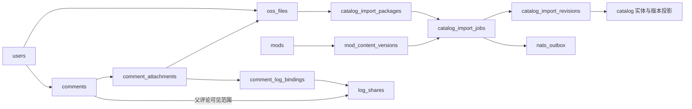

# 系统与权限地图

维护入口按用户操作排列。前端组件和 `app/_lib` 位于 frontend 仓库，Java 类及 `schema/` 位于 exporter，其余源码均在 backend。精确 HTTP 方法、路径和中间件以路由及各模块注册函数为准。[路由注册](../internal/httpapi/server.go) · [当前版本与验收](governance.md#当前版本与验收)

## 游戏包到公开目录

1. Fabric 或 Forge 的客户端入口把命令、tick 与资源生命周期连接到 common 的 `McModsExporter`、`ExportJob`。Minecraft 1.20.1、JDK 17、Architectury 9.2.14，JEI 适配 15.20.0.133。命令按命名空间、profile 导出文件与 manifest，玩家取得本地 ZIP。渲染和游戏对象读取具有线程约束。[生产端与协议](https://github.com/mcmods-cn/mcmods_exporter)
2. 项目资料编辑页调用 `uploadModExportPackage`。浏览器读 manifest，拒绝将 `all_namespaces=true` 的离线包归给单个项目。哈希、预签、分片或单段上传、完成确认、创建任务依次执行，由 `oss-upload.ts` 和 `mod-export-api.ts` 分工。接口接受任务后返回 202。进度页经 `job-polling.mts` 读取受当前用户与项目权限约束的任务。
3. `requireModEditor`、`createModExportJob` 检查项目编辑权限、目标版本、文件所有者、分类与来源。在同一事务内登记包、导入任务及出站事件。相同字节仍绑定到具体上传、项目和版本。Worker 重新读取字节计算哈希，校验 ZIP、schema、MODID、加载器及版本；需要确认时保存任务状态等待用户处理。
4. `catalogImportEligibilityTx` 用事务当前账号、RBAC、目标版本及入队时记录的发布模式判断是否可执行。源快照、模板、槽位、素材按修订和执行租约分段落库。衍生对象先登记，后续尝试根据 `run_token` 激活或补偿。人工录入字段、来源和授权通过现有投影规则保留。
5. `ready/partial` 描述导入结果；`current_stage=review` 表示等待审核。管理员路由下的 `activateModExportRevision` 同样接受持有适用审核权限的账号。通过审核或已有明确的自动发布授权后，生效修订、资源投影、JEI 模板和目录代数在同一事务提交。通过 `internal/catalogvisibility` 的公开来源才能进入目录、资源媒体或短链。[审核范围](game-import-review-scope.md) · [目录来源](public-catalog-source-policy.md)
6. 前端从 `/api/v1/recipe-types`、`/api/v1/catalog/recipes/{publicId}/render` 和项目资料 API 读取投影，`UnifiedRecipeCard` 等呈现数量、单位、候选与几何区域。空槽不构成输入，缺失顺序、未知概率及已知零各有意义。类别 catalyst 与槽位角色独立；`rect` 用于交互，`visual_rect` 用于绘制。[Fabric 与 Forge 的真实重放包](../internal/httpapi/testdata/game-20261121/provenance.json) · [存量 JEI 几何的核对与重新审核](import-asset-registry.md)

## 其他业务的入口与边界

| 用户操作和结果 | HTTP / 业务入口 | 权威数据及后续动作 |
| --- | --- | --- |
| 浏览、投稿、编辑 Mod、整合包、插件、地图、材质、光影、数据包和附属项目 | `mod_handlers.go`、`modpack_handlers.go`、`simple_project_handlers.go`，对应前端的各类项目路由。简单类型共用 `/content-projects/{projectType}` | `mods`、`modpacks`、`simple_projects` 保存领域差异。草稿、修订、变更请求与审核记录保存归属和提交时版本。作者绑定、文件、画廊和更新日志分别作权限判断。公开搜索使用数据库或可用的 Typesense 投影。 |
| 从外部元数据建立草稿，发布版本文件/画廊/日志 | `createProjectMetadataImport` → `mod_metadata_import_jobs` → `ModMetadataImportWorker`；`project_file_handlers.go`、`mod_gallery_handlers.go`、`project_changelog_handlers.go` | 元数据结果回到编辑器，审核和发布另行提交。文件绑定所属项目和批准状态，更新日志按项目分类、修订和本地化。有事件才触发关注者通知。 |
| 管理 Minecraft 服务器、作者、团队 | `server_catalog_handlers.go`、`server_review_handlers.go`、`server_probe_scheduler.go`；`project_authorship_handlers.go`、`project_editor_application_handlers.go` | 服务器有证明材料和独立审核队列。探测走 `internal/serverprobe`。个人认领、团队成员和可授予权限的作者关系分别存储，通过 `effective_project_access` 投影。 |
| 注册、登录、邮件/OAuth、注销，管理启动器及皮肤 | `auth_session.go`、`auth_cache.go`、`oauth_handlers.go`；`yggdrasil_auth.go`、`yggdrasil_session.go`、`skin_texture.go` | HttpOnly 会话与访问版本关联；前端 `api.ts`、`auth.ts` 统一处理失效。启动器凭据、join session、纹理和普通网页会话有各自作用域。邮件及第三方回调受服务端配置约束。 |
| 投稿教程、新闻、讨论、问题；评论/回复、评分、举报 | `/community/posts`、`community_post_handlers.go`、`comment_handlers.go`、`rating_handlers.go` 和 `report_*` | 社区文章用修订和审核发布；评论绑定真实对象、回复关系和楼层。举报证据有独立可见性、保留期与处置记录。回答赏金使用资金事务。 |
| 收藏、关注、导出收藏夹、接收通知/私聊、查看统计和奖励 | `favorite_handlers.go`、`favorite_modpack_export*.go`、`project_follow_handlers.go`、`message_handlers.go`、`notification_worker.go`、`/realtime/events` | .mrpack 使用任务快照、租约、来源验证和限时产物。通知/对话、已读及流水持久化于 PostgreSQL，SSE 只配送变化。统计走 `internal/activity`、`userstats`、`progression`，余额通过 `economy_ledger_store.go` 更新。 |
| 上传、日志分享、蓝图预览与在线工具 | `oss_upload_byte_binding*.go`、`oss_multipart_sessions.go`、`log_share_handlers.go`、`blueprint_worker.go`、前端 Markdown/PlantUML 工具 | 完成确认核对实际字节。原文件与已脱敏日志、衍生蓝图、纹理分别授权。OSS 删除、未完成分片清理及处理失败均有自身恢复路径。前端 PlantUML 使用配置的同站服务。 |
| 搜索、翻译、自动更新、爬虫及管理 | `internal/searchindex`、`ai_translation.go`、`seed_crawler_worker.go`、`project_automation_worker.go`、`admin_*_handlers.go` | 搜索可从权威库重建，AI 任务有预留和结果验证，外部供应商结算有不确定窗口。爬虫与自动更新关联自动化身份与租约；设置、用户管理、审核、基础设施按各自权限读取和写入。 |

## 数据标识、事务与缓存

当前 PostgreSQL 基线为 generation 172。安装顺序在 `internal/database/schema.go`，版本、定义和实库结构由 `initialize.go` 核对。外部更新日志和镜像下载按项目、供应商和各自的外部标识确定唯一归属。评分资格由账号状态、安全分及项目开发者关系决定。评分行记住已计入的贡献，修改评分、资格变化及删除沿同一触发器维护项目、类别与维度；热度事件按首次发布或恢复公开时的信任权重计入，撤销使用原权重。爬虫候选的首次草稿时间也是每日额度的统计依据。资料、审核、日志短链和队列的关键持久关系如下。

- 普通项目修订共用 `createContentRevisionTx`。同一项目行锁确认类型、公开 ID 和基线。项目、社区内容和服务器的审核入口在锁住提交后调用 `requireCurrentWriteActor`，重新核对当前会话以及当前目标的适用权限。治理隐藏由 `checkProjectRevisionModerationTx` 约束普通批准、驳回及自动发布。资料目录由 `publishCatalogRevisionsTx` 统一应用审核和投影。[审核权限入口](../internal/httpapi/review_permissions.go)
- 评论衍生日志以 `comment_scope_id` 绑定父评论，准备工作在租约内读取自有文件。发布、绑定、附件就绪与租约终态在同一事务中完成。metadata、chunk、下载都检查当前父评论和目标范围。

- 多数站内对象用 bigint 关联，用全局注册的随机 `public_id` 对外访问。项目路由可有 slug，技术字段另有 Minecraft 的 `namespace:path`、供应商 ID、包哈希、导入 UUID 和事件 ID。前端不得用导入源 ID 推导站内身份。[双 ID 架构](dual-id-architecture.md)
- 导入修订唯一键含项目、目标版本、来源类型、命名空间和修订号，部分唯一索引约束同一范围的活动修订。批准前取版本 advisory lock，再锁版本行和修订；归档检查与审核事实共同提交。人工和导入内容在同一资料版本中按 provenance 决定覆盖范围。[执行策略](../internal/httpapi/catalog_import_execution_policy.go) · [投影规则](../internal/httpapi/mod_export_content_sync.go)
- `queue.EnqueueTx` 与业务事实同事务，`nats_outbox` 保留分发意图。PubAck 与数据库标记之间可能重投。通知、消费去重、任务领取、外部交付分别依自己的持久状态；单一 broker ACK 无法证明供应商扣费结果。[任务恢复](queue-recovery.md) · [翻译预算与恢复](ai-translation-reliability.md)
- 公开目录键含 `public-source:v1`、语言/查询维度及 `catalog_dataset_state.version`。设置使用 `settings:v<version>:<key>`。会话缓存键为指纹，授权键含 RBAC、项目 ACL、用户权限版本，撤销、到期和共享缓存故障分别处理。用户私有授权信息沿独立的读取路径。持久写入及必要失效在领域入口处理。[缓存和失效](../CACHE_KEYS_AND_INVALIDATION.md)
- 关注数量、未读、站点统计与搜索投影各有重算/补偿，数据库中的操作、发布或账务事实优先。查询缓存共有 singleflight 和有界本地后备；敏感限流、会话撤销使用共享状态或数据库校验。[活动摄取](ACTIVITY_INGESTION.md) · [共享限流](redis-rate-limiting.md)

## 谁可以执行哪些操作

| 身份 | 授权依据 |
| --- | --- |
| 访客 | 公开查询先按项目、版本、修订、来源过滤。上传原包及待审衍生物沿文件/修订授权入口读取。 |
| 登录用户、投稿人 | 账号取得基本节点后可投稿、管理自己的草稿和任务。提交关系保留出处，项目编辑或所有者权限须有单独来源。 |
| 项目编辑员、审核者 | 已批准 assignment、有效 RBAC 或适用的项目关系授予范围权限。精确项目审核权限只覆盖该项目且要求不同提交人。既有全站 `content.review`、`project.review` 和管理员审核规则允许相应内容的自审，具体业务可要求更严格独立身份。 |
| 个人作者、团队 | 认领个人作者必须由另一账号审核；团队通过已批准成员关系及项目 `permission_granting` 关系推导权限。展示署名有独立语义。 |
| 管理员、自动化账号 | 管理动作由权限节点及审计保护。自动化任务用已配置身份，并在执行/发布处重新检查当前授权和状态。特定免审权限与仅可编辑的权限分开。 |

完整角色来源、叠加与撤销见[项目权限](../PROJECT_PERMISSION_MODEL.md)，会话与 RBAC 的版本变化见[认证与授权版本](../AUTH_AND_PERMISSION_VERSIONING.md)。

## 第二轮审查范围

以下为第二轮的追踪记录，描述当时的写入边界、缺口和实测。当前审核、安装和运行结果见本页前述入口及[当前验收](governance.md#当前版本与验收)，阶段性结果见[第二轮验收台账](governance.md#第二轮工作记录)。

| 业务与前端入口 | 后端权威入口、权限与副作用 | 本轮核对及处理 |
| --- | --- | --- |
| 创建、编辑、审核 Mod、整合包及六类简单项目，作者认领或团队关系。入口为 `app/mods`、`app/modpacks`、各简单项目目录及后台项目审核 | `createMod`、`createModpack` 和 `createSimpleProject` 写分域表及提交流水。按 `project.edit.<ID>` 等权限编辑。读了 `reviewModRevision` 的变更请求锁与基版检查，`reviewCreatorClaim` 的独立身份规则和 `reviewProjectAuthorshipRelation` 的关系授权。首发或审核变更在同一事务登记活动和所需异步对象处理。 | 真实 PG 回归验证创建或修订的活动回滚、作者独立审核和修订读回失败。目录资料批准在目标锁后另核对现时权限。一般项目修订使用进入请求时已校验的权限，锁等待期间的撤权语义仍应按该业务另验。 |
| 登录、退出、撤权、OAuth、私有皮肤及启动器接口。入口为 `app/login`、`app/_lib/auth.ts` 和皮肤页 | `cookieRequestOrigin` 校验 Cookie 写入来源，OAuth 使用配对的 state Cookie，`readSessionSubject` 与权限版本同一主库查询。Yggdrasil 使用自己的令牌记录及签名。纹理改写在请求体读取后检查授权，私有图片必须通过所有权与资产可见性。 | 真实 PG/Redis 双实例逐项核对个人授权、RBAC、项目 ACL 和 auth version。真实 HTTP 验证错误的 OAuth 设置不会覆盖密钥、Yggdrasil 私有链和上传期间撤权。真实 OAuth 提供商、签名密钥迁移和启动器联网未执行。 |
| 项目资料编辑、上传分片、恢复、提交审核、公开目录与游戏渲染。入口为 `app/mods/[siteId]/data`、`mod-export-api.ts` 和 `oss-upload.ts` | `createModExportJob` 在同一事务绑定上传用户、项目、版本、原包与 outbox。Worker 以 `run_token` 领取、续期、入库，批准通过 `publishCatalogRevisionsTx` 应用来源投影。分片完成核对字节与配额，公开读按 approved/active 和来源过滤。 | 实测账号隔离、分片幂等、审核回滚与目录布局。真实游戏包的 ZIP 哈希、投递和浏览器像素另列。旧整库 API 在 100 条和 2 MiB 以内完整返回，超限用 422 和 Link 指向分页。分页默认 80、最多 100 条。两路通过同一公开性回归。 |
| 社区教程、新闻、讨论、反馈，评论评分举报、私信和通知。入口为社区页面、评论控件、`app/messages` 与通知中心 | `createCommunityPost`、`applyCommunityPostSnapshotTx` 管理原文与修订。评论分页限定内容及作者状态。 `sendConversationMessage` 通过 `createDirectMessageTx` 写参与方、锚点和未读，`enqueueNotificationTaskTx` 登记投递。日志附件 Worker 使用原 lease 与发布事务。 | 回归覆盖四类社区创建/审核、成员与封锁、重复及活跃会话通知、入队失败回滚。修复评论附件失败时遗留已发布的脱敏分享。评分去重与举报可见性按既有数据模型核对，真实外部邮件未发。 |
| 收藏、收藏夹详情、生成和下载 `.mrpack`。入口为 `favorite-api.ts` 的增量保存和账户收藏面板 | `persistFavoriteModpackExportPreview` 及 `loadFavoriteModpackExportPreviewForCreate` 绑定所有者、输入哈希、过期时间及一次消费。导出 Worker 重验 lease，`finalizeFavoriteExportArtifact` 在终态提交通知，未挂接对象有补偿。 | 真实 PG 核对成员变更原子性、过期租约、对象补偿与终态通知。移除一个前端无调用的整集覆盖函数，后端保留兼容 PUT。真实 CDN 流量与所有外部版本的依赖完整性未实测。 |
| 余额、库存、转账、下载奖励及悬赏。入口为账户统计、悬赏和资料下载 | `lockCurrencyBalancesTx` 按用户 ID 取锁，`applyLockedCurrencyBalanceChangeTx` 同事务更新余额和流水。 `recordOwnedContentDownloadTx` 读取下载配置并同步登记经济事实。 | 定向 PG 核对库存与等级组合、撤销权限、并发悬赏和奖励回滚。现金对账、站点真实历史余额与高峰吞吐留给部署环境。 |
| AI 配置、翻译、任务恢复和预算。入口为 `admin-ai-settings.tsx`、队列日志和翻译编辑器 | `readAIConfigSetting` 共用解封与数值校验。 `updateAIConfig` 使用 `ai.write` 和锁内版本比较。执行前授权与预算预留由 worker 事务复核，manual 翻译保持优先，重复投递沿现有任务代次。 | 两个真实 HTTP 管理员和只读身份验证预算及字段冲突、空值、密文保留、密钥换源和清理。浏览器验证相同能力。账单使用合成响应，未向供应商请求。供应商已受理但使用量不明时保留既有核对流程。 |
| 外部项目导入、爬虫、自动更新、服务器探测和搜索。入口为项目编辑器、服务器目录和后台维护 | `ProjectAutomationWorker.processOne` 领取后由 `lockProjectAutomationRunTx` 复核租约、来源和设置。跨池镜像用 `acquireProjectAutomationMirrorSlot`。下载客户端要求受支持 URL，对重定向做同供应商核对和凭据剥离。搜索索引为派生结果，最终可见性回读 PostgreSQL。 | 实测迟到尝试、崩溃次数终止、爬虫心跳及真实 Typesense 的投影与游标。省去更改独立供应商策略。探测器、互联网 CDN、跨节点商业安装分别留验证边界，禁止用当前回环替身代表线上。 |
| 后台配置、日志分享、蓝图和 Markdown，游戏资源与诊断。入口为 `app/admin`、`app/tools`、资料编辑器与 exporter | `admin-panels.tsx` 管理面板标识、能力和入口。Markdown 跳过原始 HTML，检查链接，draw.io 按用户选择发送，PlantUML 使用固定代理。后端私有原件保持所有权引用，日志共享仅发布脱敏条目。Java 私有诊断文件在导出树外，结构化 manifest 被单独读回。 | 核对设置失败和安全来源、布局重命名的语言字段、评论附件事务。真实 Chromium 实测读/写和移动状态。工具链、游戏样包及分阶段耗时有独立证据，未将弃用历史报告或删除代码量计作验收。 |
